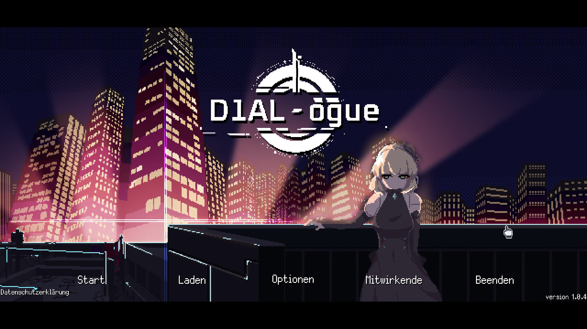

# D1AL-ogue – Deutsche Fan-Übersetzung

Inoffizielle deutsche Übersetzung von **[D1AL-ogue](https://store.steampowered.com/app/4270390/)** (CherryPicker).
Übersetzt sind **alle 4.091 Texte**: sämtliche Dialoge und Zwischensequenzen (Intro, Tag 1–7, alle vier Enden,
Abspann), Menü, Tutorial, Kundenkommentare und News.



> **Hinweis:** Die Übersetzung wurde mit KI (Claude) erstellt – mit gemeinsamem Glossar, festgelegter Anrede
> (du/Sie) pro Figurenpaar und automatischen Prüfungen – und stichprobenartig im Spiel getestet, aber nicht
> vollständig von Menschen korrekturgelesen. Fehler bitte als [Issue](../../issues) melden.
>
> Fan-Projekt ohne Verbindung zu CherryPicker. Alle Rechte am Spiel liegen beim Entwickler.

## Installation

1. **[Neuestes Release](../../releases/latest)** herunterladen und entpacken.
2. D1AL-ogue beenden, `D1AL-ogue_DE_Patcher.exe` starten, **[1] Installieren** wählen.
   Der Spielordner wird über Steam automatisch gefunden.
3. Im Spiel als Sprache **English** einstellen – die Texte erscheinen auf Deutsch.

Getestet mit Spielversion 1.0.4 (Steam-Build 24985627).

**Deinstallieren:** Patcher starten → **[2] Deinstallieren** (oder in Steam „Dateien auf Fehler überprüfen“).
**Nach einem Spiel-Update:** Patcher einfach erneut ausführen.

Windows SmartScreen warnt evtl., weil die `.exe` nicht signiert ist („Weitere Informationen“ → „Trotzdem ausführen“).
Wer lieber kein Binary startet: `pip install UnityPy` und `python patcher/d1al_de_patcher.py install`.

## Wie es funktioniert

D1AL-ogue nutzt Unity Localization mit Addressables. Der Patcher

- schreibt die deutschen Texte in das **englische** String-Table-Bundle
  (`StreamingAssets/aa/StandaloneWindows64/localization-string-tables-english(unitedstates)(en-us)_assets_all.bundle`),
- setzt im Addressables-Katalog (`StreamingAssets/aa/catalog.bin`) die CRC dieses einen Bundles auf 0 –
  sonst verweigert das Spiel das Laden („CRC Mismatch“),
- sichert vorher beide Originale (`StreamingAssets/aa/_D1AL-ogue_DE_backup/`, mit SHA-256-Manifest) und erkennt
  Spiel-Updates sowie bereits gepatchte Dateien ohne Sicherung.

Es werden **keine Spieldateien** verteilt – nur die deutschen Texte (`translation/D1AL-ogue_DE.json`)
und der Patcher, der die Änderung auf dem eigenen Rechner vornimmt.

## Repository

| Pfad | Inhalt |
|---|---|
| `patcher/` | Patcher (`d1al_de_patcher.py`), Build-Skript für die `.exe`, `LIESMICH.txt` fürs Release |
| `translation/D1AL-ogue_DE.json` | Übersetzung: `"Tabelle\|Key": "deutscher Text"` (vom Patcher gelesen) |
| `translation/ass/*.de.ass` | Arbeitsdateien der Übersetzung (pro Kundenbesuch/Tabelle, Sprecher & Szenentyp je Zeile) |
| `translation/glossar.md` | Verbindliches Glossar: Figuren, Anrede, Begriffe, Konventionen |
| `tools/` | Werkzeuge für Extraktion, ASS-Erzeugung, Prüfung – siehe [tools/README.md](tools/README.md) |

Die englischen Originaltexte sind bewusst **nicht** im Repository; `tools/extract_tables.py` erzeugt sie bei
Bedarf aus der eigenen Spielinstallation.

### Patcher bauen

```powershell
powershell -ExecutionPolicy Bypass -File patcher\build.ps1
```
Erzeugt `dist\D1AL-ogue_DE_Patcher.exe` und `dist\D1AL-ogue_DE_v<Version>.zip`.

## Lizenz

Quellcode (`patcher/`, `tools/`): [MIT](LICENSE). Die Übersetzungstexte sind eine nicht-kommerzielle
Fan-Übersetzung; die Rechte am Spiel und seinen Originaltexten liegen bei CherryPicker.
